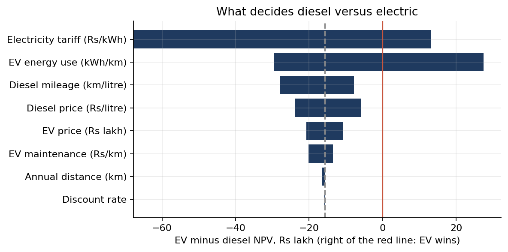

# EV Fleet Real Options, India

Should an Indian trucking operator buy a diesel truck, buy an electric truck, or wait a year and decide with better information? Version 1 answered with a real-options model (a binomial lattice on the diesel price). Version 2 audits that answer.

## v2 (October 2026): the verdict was a coin toss

[`notebooks/ev_vs_diesel_audit.ipynb`](notebooks/ev_vs_diesel_audit.ipynb) replicates every v1 number in Python (diesel ₹52.8 lakh, EV ₹37.1 lakh, breakeven ₹117.31 a litre, option value ₹0), then finds:

- **The model holds diesel at today's price for each truck's eight-year life**, while drifting it 5.1% a year between decisions. With the model's own drift inside each truck's life, diesel is worth ₹39.7 lakh against the EV's ₹37.1 lakh: **the 42% gap becomes 7%**.
- **The two trucks do different jobs.** The Ashok Leyland AVTR 1920 is an 18.5-tonne 4x2 haulage truck ([cardekho](https://trucks.cardekho.com/en/trucks/ashok-leyland/1920/specifications)). The Tata Prima E.28K is a 28-tonne 6x4 mining and construction tipper ([trucksbuses.com](https://www.trucksbuses.com/trucks/tipper/tata-prima-e.28k/specifications)). Both are credited with the same freight per km.
- **The EV cannot drive the assumed distance.** 90,000 km a year is about 300 km a working day; one 175 km charge a day covers about 52,500 km a year.
- **India's "7% diesel volatility" partly measures a subsidy.** The 2015-2026 window includes a nationwide retail price freeze, April 2022 to 15 May 2026, which broke with an 8.6% rise in ten days during the 2026 oil shock. The price series also rises 11% during the freeze, so its basis is unclear. Eleven annual returns put volatility anywhere from 4.9% to 12.3%.
- **What decides the answer is the electricity tariff and the EV's energy use, not diesel.** Running costs per km are almost equal (₹21.41 EV, ₹21.82 diesel). Across plausible inputs, the EV wins in **44.5%** of 20,000 Monte Carlo draws; tariff and energy use dominate (rank correlations -0.65 and -0.63).
- **The option to wait is worth zero for a structural reason.** In the tree, waiting means idling a year's business (about ₹16 lakh of cash flow). The real option a fleet holds is switching technology at the next replacement, which a single-purchase tree cannot represent.



## v1 method (unchanged)

A 6-year recombining binomial lattice on the diesel price (u = exp(sigma), d = 1/u, drift-matched up-probability). At each node, backward induction picks the best of buying an EV, buying a diesel truck, or waiting a year. Inputs and their sources are in the workbook's `Inputs` sheet; operating estimates (tariff, maintenance, freight rate, distance) are flagged there as estimates.

## Repository

```
notebooks/ev_vs_diesel_audit.ipynb   v2: replication, inconsistencies, volatility, tornado, Monte Carlo, option analysis
data/                                diesel price series, calibration script and output
excel/                               v1 workbook generator and workbook
charts/                              v1 and v2 figures
results_v2.json                      every number in the v2 notebook
```

Regenerate: `python data/calibrate_volatility.py`, `python excel/build_model.py`, `python charts/build_charts.py`; then execute the notebook (`jupyter nbconvert --to notebook --execute --inplace notebooks/ev_vs_diesel_audit.ipynb`).
